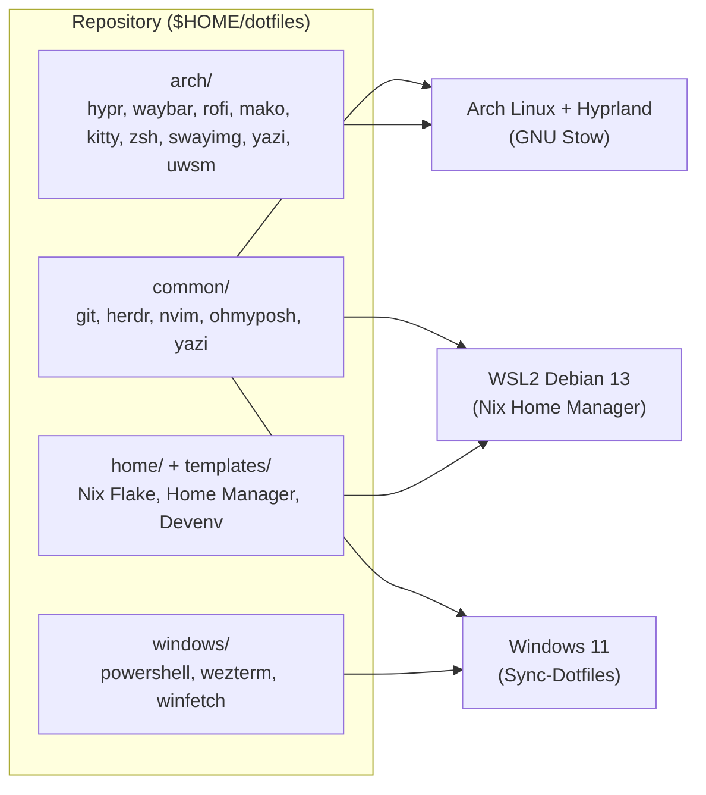
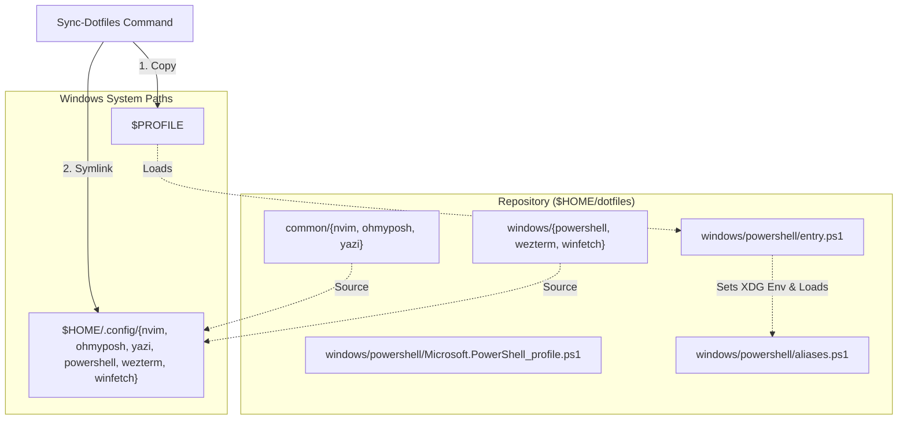

# ❄️ Angel's Dotfiles

A modular, clean, and performance-focused multi-host developer environment spanning **Arch Linux + Hyprland**, **Linux on WSL2 (Debian 13 + Nix Home Manager)**, and **Windows 11 (PowerShell 7 + WezTerm)**.

---

## Repository Architecture

Configurations are separated by target platform so each machine deploys only what it needs—without hidden `.` directories—directly into `$XDG_CONFIG_HOME` (`~/.config`):



| Directory | Target Host(s) | Deployment Mechanism | Contents |
| :--- | :--- | :--- | :--- |
| **`common/`** | Arch, WSL2, Windows | Stow / Home Manager / `Sync-Dotfiles` | [`nvim`](common/nvim/README.md), [`herdr`](common/herdr/README.md), `ohmyposh`, `yazi`, `git` |
| **`arch/`** | Arch Linux + Hyprland | GNU Stow (`stow -d ~/dotfiles -t ~/.config common arch`) | [`hypr`, `waybar`, `rofi`, `mako`, `kitty`, `zsh`, `swayimg`, `yazi`, `uwsm`](arch/README.md) |
| **`windows/`** | Windows 11 Host | PowerShell `Sync-Dotfiles` | `powershell`, `wezterm`, `winfetch` |
| **`home/`** | WSL2 (Debian 13) | Nix Flake + Home Manager (`home-manager switch`) | Declarative packages, XDG env, Zsh, Git, Neovim & Herdr links |
| **`templates/`** | WSL2 / Nix Projects | `nix flake init -t ~/dotfiles#<template>` | Lightweight `devenv` project templates (`bun`, `c`, `cpp`, `node`, `python`) |

### Module Guides
*   **[Arch Linux + Hyprland Guide](arch/README.md)** — Package list, GNU Stow deployment, `UWSM` + `systemd --user` services, and keybindings reference.
*   **[Herdr Multiplexer Setup](common/herdr/README.md)** — Pinned plugin installation (`herdr-nvim-nav`, `worktree-setup`), host profiles, and multiplexer keybindings.
*   **[Neovim / VSCode Keymaps](common/nvim/README.md)** — Quick reference for editor navigation and sidebar shortcuts.

---

## 1. Arch Linux + Hyprland Setup (GNU Stow)

The portable **Arch Linux** environment uses **GNU Stow** to symlink `common/` and `arch/` directly into `~/.config` with a switchable Day/Night UI theme inspired by *NieR:Automata* and ultra-low RAM/CPU overhead:

```bash
mkdir -p \
  ~/.config/waybar \
  ~/.config/rofi \
  ~/.config/herdr/plugins/config/tdi.worktree-setup \
  ~/.config/systemd/user \
  ~/.config/btop/themes

stow --restow -d ~/dotfiles -t ~/.config common arch
~/.config/hypr/scripts/theme.sh init
```

See **[arch/README.md](arch/README.md)** for full post-install steps (`systemd --user` units and keybindings).

---

## 2. WSL2 Linux Setup & Updates (Nix + Home Manager)

On **WSL2 (Debian + Nix Home Manager)**, user packages, XDG compliance, and links into `common/` are managed declaratively via **Nix** and **Home Manager**:

1.  **Backup legacy configuration** (if any exists):
    ```bash
    mv ~/.config/home-manager ~/.config/home-manager-backup
    ```
2.  **Synchronize via symbolic link (`ln -s`)**:
    ```bash
    ln -s ~/dotfiles ~/.config/home-manager
    ```

### Running Home Manager Switch

Because the repository is symlinked to `~/.config/home-manager`, configuration changes can be built and applied from any directory:

```bash
home-manager switch
```

To dry-run and verify the Nix configuration before applying changes:
```bash
home-manager build
```

### Nix Flake Update & Dependency Upgrades

1.  **Update `flake.lock`**:
    ```bash
    nix flake update
    ```
2.  **Rebuild and apply**:
    ```bash
    home-manager switch
    ```

> [!NOTE]
> Update a single input (e.g., `nixpkgs`) with `nix flake update nixpkgs`.

---

## 3. Core Shell Utilities

Traditional CLI tools are replaced across hosts with fast, modern alternatives:

| Command | Alternative | Description |
| :--- | :--- | :--- |
| `cat` | **`bat`** | `cat` clone with syntax highlighting and Git integration. |
| `man` | **`batman` / `bat`** | Manpage viewer styled with `bat` syntax highlighting. |
| `ls` | **`eza`** | Modern `ls` replacement with icons, colors, and Git status. |
| `cd` | **`zoxide`** | Smart directory jumper (`z`) that learns navigation habits. |
| `find` | **`fd`** | Fast, user-friendly alternative to `find`. |
| - | **`fzf` / `PSFzf`** | Fuzzy finder for files, command history, and completions. |
| `ranger` | **`yazi`** | Terminal file manager with Kitty graphics image previews. |
| `top` | **`btop`** | Interactive terminal resource monitor. |
| `curl` | **`xh`** | Fast, ergonomic HTTP client (WSL2/Windows). |
| `neofetch`| **`fastfetch`** | Ultra-fast system information tool. |
| `nix shell`| **`,` (comma)** | Run commands from `nixpkgs` on the fly via `nix-index` (WSL2). |

---

## 4. Nix Flake Templates (Devenv — WSL2)

To keep project-level development environments clean and isolated, this repository exports lightweight **Devenv templates**:

*   `bun`: Bun runtime, lockfiles, and environment checks.
*   `c`: C development environment (`gcc`).
*   `cpp`: C++ development environment (`g++`).
*   `node`: Node.js development (pinned to Node 22).
*   `python`: Python interpreter and virtual environment tooling.

### Bootstrapping a New Project
Run inside the target project directory:
```bash
nix flake init -t path:$HOME/dotfiles#<template>
```

This initializes `devenv.nix`, `devenv.yaml`, and `.envrc`. Activate automatically with `direnv allow` or manually inside an isolated subshell with `devenv shell`. Run formatting/git hooks manually with:
```bash
devenv tasks run devenv:git-hooks:run
```

---

## 5. Windows & PowerShell Sync System

On Windows 11, dotfiles live under `$HOME\dotfiles` and symlink `common/` (`nvim`, `ohmyposh`, `yazi`) plus `windows/` (`powershell`, `wezterm`, `winfetch`) into `$HOME\.config`:



### Initial Setup Steps on Windows
1.  Clone this repository to `$HOME\dotfiles` (`C:\Users\<username>\dotfiles`).
2.  Open **PowerShell 7+** (loaded by default in [wezterm.lua](windows/wezterm/wezterm.lua)):
    ```powershell
    cd ~/dotfiles
    Set-ExecutionPolicy -ExecutionPolicy RemoteSigned -Scope CurrentUser -Force
    . .\windows\powershell\aliases.ps1
    Sync-Dotfiles
    ```

---

## 6. XDG Base Directory Compliance

XDG compliance is enforced both in [home/shell.nix](home/shell.nix) (WSL2) and in [arch/uwsm/env](arch/uwsm/env) + [arch/zsh/.zshenv](arch/zsh/.zshenv) (Arch Linux), keeping `$HOME` clean by redirecting caches, state, and histories (`ZDOTDIR`, `HISTFILE`, Git config, NPM, Cargo, Go, Python) into `$XDG_CONFIG_HOME`, `$XDG_DATA_HOME`, `$XDG_STATE_HOME`, and `$XDG_CACHE_HOME`.

---

## 7. Maintenance & Disk Cleanup

### Arch Linux (`pacman` & Journal)
*   **Clean uninstalled package cache & keep last 2 versions**:
    ```bash
    sudo pacman -Sc
    ```
*   **Remove orphaned dependencies**:
    ```bash
    sudo pacman -Rns $(pacman -Qdtq)
    ```

### Nix & Home Manager (WSL2)
*   **Expire old Home Manager generations & collect garbage**:
    ```bash
    home-manager expire-generations "-14 days"
    nix-collect-garbage -d
    nix store optimise
    ```
*   **Garbage collect old Devenv shells**:
    ```bash
    devenv gc
    ```
